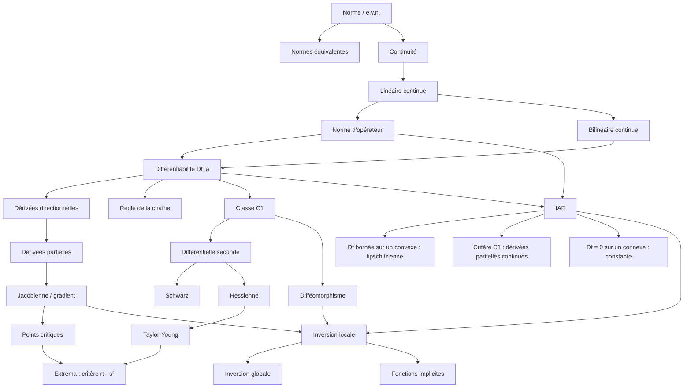

---
aliases:
  - "Index Calcul Différentiel"
  - "Sommaire CD"
  - "Index des définitions CD"
tags:
  - cd
---

# 🗂️ Calcul différentiel – Index des définitions, théorèmes et méthodes

Point d'entrée pour retrouver n'importe quelle notion. Dans Obsidian : `Ctrl/Cmd + O` puis tape le nom (les alias marchent : « IAF », « jacobienne », « Schwarz », « rt-s² », « TFI »…). · Retour à la [[L3/Calcul Différentiel/README|fiche matière]]

La numérotation (Déf. 2.3, Th. 3.11…) est celle du **cours rédigé** ([PDF](fichiers/cd-cours-redige-ch1-5.pdf)).

## 🚀 Révision express

- 📅 [[cd-plan-de-revision|Plan de révision]] : quoi faire, jour par jour
- 📘 [[cd-fiche-definitions|Toutes les définitions sur une page]] · ⭐ [[cd-fiche-theoremes|Tous les énoncés sur une page]]
- 🧭 [[cd-reconnaitre-exercice|Reconnaître le type d'exercice]] : énoncé → méthode → première phrase
- ✍️ [[cd-exercices-types-corriges|Exercices types corrigés]] (rédactions modèles)
- ✅ [[cd-vrai-faux-classiques|Vrai/Faux classiques]] · 🚨 [[cd-mes-erreurs|Mes erreurs à ne plus faire]]

## 📘 Définitions par chapitre

### [[01-espaces-vectoriels-normes|1 – Espaces vectoriels normés]]
- [[norme|Norme, espace vectoriel normé]] · *Déf. 1.1*
- [[boules-spheres|Boules et sphères]] · *Déf. 1.6*
- [[norme-produit|Norme produit]] · *Prop. 1.8*
- [[normes-equivalentes|Normes équivalentes]] · *Déf. 1.10*
- [[suite-convergente|Suite convergente]] · *Déf. 1.15*
- [[ouvert-ferme|Ouvert, fermé]] · *Déf. 1.20*
- [[voisinage|Voisinage]] · *Déf. 1.26*
- [[continuite|Continuité en un point]] · *Déf. 1.28*
- [[continuite-uniforme|Continuité uniforme]] · *Déf. 1.31*
- [[application-lipschitzienne|Application lipschitzienne]] · *Déf. 1.33*
- [[application-lineaire-continue|Application linéaire continue, espace Lc(E,F)]] · *§ 1.9*
- [[norme-operateur|Norme d'opérateur]] · *Déf. 1.48*
- [[application-bilineaire|Application bilinéaire (continue)]] · *Déf. 1.52*
- [[suite-de-cauchy|Suite de Cauchy]] · *Déf. 1.56*
- [[espace-de-banach|Espace complet, espace de Banach]] · *Déf. 1.58*

### [[02-applications-differentiables|2 – Applications différentiables]]
- [[petit-o|Petit o]] · *Déf. 2.1*
- [[differentiabilite|Différentiabilité en un point, différentielle]] · *Déf. 2.3*
- [[derivee-directionnelle|Dérivée directionnelle]] · *Déf. 2.8*
- [[classe-c1|Application de classe C1]] · *Déf. 2.12, 2.13 et 3.14*
- [[differentielle-partielle|Différentielle partielle]] · *Déf. 2.27*
- [[derivee-partielle|Dérivée partielle]] · *Déf. 2.30*
- [[matrice-jacobienne|Matrice jacobienne]] · *Déf. 2.36*
- [[gradient|Gradient]] · *Déf. 2.39*

### [[03-accroissements-finis|3 – Accroissements finis]]
- [[segment-et-convexe|Segment, partie convexe]] · *Déf. 3.3 et 3.4*
- [[partie-connexe|Partie connexe]] · *Déf. 3.20*

### [[04-differentielles-ordre-superieur|4 – Différentielles d'ordre supérieur]]
- [[differentielle-seconde|Différentielle seconde, classe C2]] · *Déf. 4.1 et 4.4*
- [[derivees-partielles-ordre-2|Dérivées partielles d'ordre 2]] · *Déf. 4.8*
- [[matrice-hessienne|Matrice hessienne]] · *Déf. 4.13*
- [[extremum-local|Extremum local, extremum global]] · *Déf. 4.17 et 4.18*
- [[point-critique|Point critique]] · *Déf. 4.19*
- [[classe-cn|Différentiabilité d'ordre n, classes Cn et C∞]] · *Déf. 4.29*

### [[05-inversion-locale-fonctions-implicites|5 – Inversion locale et fonctions implicites]]
- [[diffeomorphisme|Difféomorphisme, difféomorphisme local]] · *Déf. 5.1*

## 🔤 Définitions par ordre alphabétique

- [[application-bilineaire|Application bilinéaire (continue)]]
- [[classe-c1|Application de classe C1]]
- [[application-lineaire-continue|Application linéaire continue, espace Lc(E,F)]]
- [[application-lipschitzienne|Application lipschitzienne]]
- [[boules-spheres|Boules et sphères]]
- [[continuite|Continuité en un point]]
- [[continuite-uniforme|Continuité uniforme]]
- [[diffeomorphisme|Difféomorphisme, difféomorphisme local]]
- [[classe-cn|Différentiabilité d'ordre n, classes Cn et C∞]]
- [[differentiabilite|Différentiabilité en un point, différentielle]]
- [[differentielle-partielle|Différentielle partielle]]
- [[differentielle-seconde|Différentielle seconde, classe C2]]
- [[derivee-directionnelle|Dérivée directionnelle]]
- [[derivee-partielle|Dérivée partielle]]
- [[derivees-partielles-ordre-2|Dérivées partielles d'ordre 2]]
- [[espace-de-banach|Espace complet, espace de Banach]]
- [[extremum-local|Extremum local, extremum global]]
- [[gradient|Gradient]]
- [[matrice-hessienne|Matrice hessienne]]
- [[matrice-jacobienne|Matrice jacobienne]]
- [[norme-operateur|Norme d'opérateur]]
- [[norme-produit|Norme produit]]
- [[norme|Norme, espace vectoriel normé]]
- [[normes-equivalentes|Normes équivalentes]]
- [[ouvert-ferme|Ouvert, fermé]]
- [[partie-connexe|Partie connexe]]
- [[petit-o|Petit o]]
- [[point-critique|Point critique]]
- [[segment-et-convexe|Segment, partie convexe]]
- [[suite-convergente|Suite convergente]]
- [[suite-de-cauchy|Suite de Cauchy]]
- [[voisinage|Voisinage]]

## ⭐ Théorèmes et propositions

### [[01-espaces-vectoriels-normes|1 – Espaces vectoriels normés]]
- [[seconde-inegalite-triangulaire|Seconde inégalité triangulaire]] · *Prop. 1.2*
- [[equivalence-normes-dimension-finie|Équivalence des normes en dimension finie]] · *Th. 1.13*
- [[stabilite-ouverts-fermes|Stabilité des ouverts et des fermés]] · *Th. 1.22 et 1.23*
- [[caracterisation-sequentielle-fermes|Caractérisation séquentielle des fermés]] · *Th. 1.24*
- [[continuite-et-composantes|Continuité et composantes]] · *Th. 1.40*
- [[caracterisation-lineaires-continues|Caractérisations des applications linéaires continues]] · *Th. 1.43*
- [[lineaire-en-dimension-finie|Linéaire au départ d'une dimension finie : continue]] · *Th. 1.44*
- [[caracterisations-norme-operateur|Caractérisations de la norme d'opérateur]] · *Prop. 1.50*
- [[norme-composee|Norme d'une composée]] · *Prop. 1.51*
- [[caracterisation-bilineaires-continues|Caractérisation des applications bilinéaires continues]] · *Prop. 1.53 et 1.55*
- [[espaces-de-banach-usuels|Espaces de Banach usuels]] · *Th. 1.60 et 1.61*

### [[02-applications-differentiables|2 – Applications différentiables]]
- [[differentielle-et-derivees-directionnelles|Différentielle et dérivées directionnelles]] · *Prop. 2.9*
- [[differentielles-de-reference|Différentielles de référence : constante, linéaire, bilinéaire]] · *Ex. 2.15, 2.16, 2.17*
- [[differentiable-implique-continue|Différentiable implique continue]] · *Prop. 2.18*
- [[linearite-differentielle|Linéarité de la différentielle]] · *Th. 2.19*
- [[regle-de-la-chaine|Règle de la chaîne (différentielle d'une composée)]] · *Th. 2.20, Cor. 2.26, Prop. 2.37*
- [[differentielle-et-differentielles-partielles|Différentielle et différentielles partielles]] · *Prop. 2.29, Cor. 2.32*
- [[differentiabilite-par-composantes|Différentiabilité par composantes]] · *Prop. 2.33, Cor. 2.35*
- [[differentielle-produit-bilineaire|Différentielle d'un « produit » B(f1, f2)]] · *Prop. 2.34*

### [[03-accroissements-finis|3 – Accroissements finis]]
- [[taf|Théorème des accroissements finis (TAF)]] · *Th. 3.2 et 3.6*
- [[iaf|Inégalité des accroissements finis (IAF)]] · *Th. 3.8, 3.9 et 3.11*
- [[iaf-sur-un-convexe|IAF sur un convexe : différentielle bornée implique lipschitzienne]] · *Cor. 3.13*
- [[critere-c1|Critère C1 par les dérivées partielles]] · *Th. 3.15, Cor. 3.16*
- [[differentielle-nulle|Différentielle nulle : f constante]] · *Prop. 3.18, Th. 3.25*
- [[convexe-implique-connexe|Tout convexe est connexe]] · *Prop. 3.21 et 3.22*

### [[04-differentielles-ordre-superieur|4 – Différentielles d'ordre supérieur]]
- [[theoreme-de-schwarz|Théorème de Schwarz]] · *Th. 4.6 et 4.10*
- [[expression-differentielle-seconde|Expression de la différentielle seconde]] · *Lemme 4.9, Th. 4.11, Prop. 4.14*
- [[critere-c2|Critère C2]] · *Th. 4.12*
- [[taylor-young-ordre-2|Formule de Taylor-Young à l'ordre 2]] · *Prop. 4.15*
- [[condition-necessaire-extremum|Condition nécessaire d'extremum (ordre 1)]] · *Prop. 4.20*
- [[extrema-et-hessienne|Extrema et différentielle seconde]] · *Th. 4.23*
- [[critere-rt-s2|Critère rt − s² (dimension 2)]] · *Cor. 4.25*
- [[formules-de-taylor|Formules de Taylor (ordre n)]] · *Th. 4.35, 4.37, 4.38, Cor. 4.39*

### [[05-inversion-locale-fonctions-implicites|5 – Inversion locale et fonctions implicites]]
- [[differentielle-de-la-reciproque|Différentielle de la réciproque]] · *Prop. 5.4*
- [[point-fixe-banach-picard|Théorème du point fixe de Banach-Picard]] · *Lemme 5.10*
- [[inversion-locale|Théorème d'inversion locale]] · *Th. 5.7*
- [[inversion-globale|Théorème d'inversion globale]] · *Th. 5.12, Cor. 5.13*
- [[fonctions-implicites-une-variable|Théorème des fonctions implicites (une variable)]] · *Th. 5.15*
- [[fonctions-implicites|Théorème des fonctions implicites (cas général)]] · *Th. 5.19, Cor. 5.20*

## 🛠️ Méthodes

### [[01-espaces-vectoriels-normes|1 – Espaces vectoriels normés]]
- [[montrer-norme|Méthode : montrer qu'une application est une norme]]
- [[montrer-normes-equivalentes|Méthode : montrer que deux normes sont (ou ne sont pas) équivalentes]]
- [[montrer-ouvert-ferme|Méthode : montrer qu'une partie est ouverte ou fermée]]
- [[montrer-continue|Méthode : montrer qu'une application est (ou n'est pas) continue]]
- [[continuite-application-lineaire|Méthode : continuité d'une application linéaire]]
- [[calculer-norme-operateur|Méthode : calculer une norme d'opérateur]]

### [[02-applications-differentiables|2 – Applications différentiables]]
- [[differentiabilite-par-definition|Méthode : montrer la différentiabilité par la définition]]
- [[differentiabilite-par-theoremes|Méthode : montrer la différentiabilité par les théorèmes généraux]]
- [[appliquer-regle-de-la-chaine|Méthode : appliquer la règle de la chaîne en 4 étapes]]
- [[calculer-jacobienne|Méthode : calculer une jacobienne et une différentielle sur R^n]]
- [[calculer-derivee-directionnelle|Méthode : calculer une dérivée directionnelle]]
- [[montrer-non-differentiable|Méthode : montrer qu'une application n'est pas différentiable en a]]
- [[etudier-en-un-point-particulier|Méthode : étudier une fonction en un point particulier (souvent (0,0))]]
- [[differentielle-sur-les-matrices|Méthode : calculer une différentielle sur les matrices]]

### [[03-accroissements-finis|3 – Accroissements finis]]
- [[montrer-classe-c1|Méthode : montrer qu'une application est de classe C1 (ou C2)]]
- [[utiliser-iaf|Méthode : utiliser l'inégalité des accroissements finis (montrer lipschitzienne)]]
- [[montrer-constante|Méthode : montrer qu'une application est constante]]

### [[04-differentielles-ordre-superieur|4 – Différentielles d'ordre supérieur]]
- [[calculer-differentielle-seconde|Méthode : calculer une différentielle seconde, une hessienne]]
- [[etudier-points-critiques|Méthode : étudier les points critiques d'une fonction de R²]]
- [[ecrire-taylor-young|Méthode : écrire la formule de Taylor-Young à l'ordre 2 en un point]]
- [[extremum-global|Méthode : montrer l'existence d'un extremum global]]

### [[05-inversion-locale-fonctions-implicites|5 – Inversion locale et fonctions implicites]]
- [[montrer-diffeomorphisme|Méthode : montrer qu'une application est un difféomorphisme (local ou global)]]
- [[fonction-implicite|Méthode : étudier une fonction implicite (existence, dérivée, DL)]]

## 🧩 Catalogue

- [[exemples-et-contre-exemples|Exemples et contre-exemples classiques]]

## 🗺️ Comment les notions s'enchaînent

