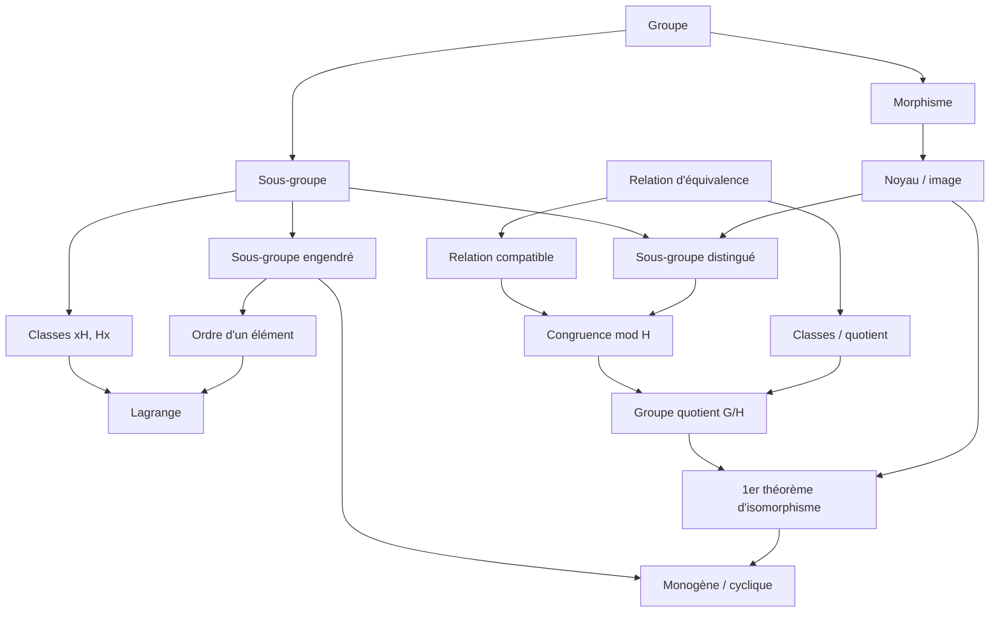

---
aliases:
  - "Index des définitions"
  - "Sommaire GAC"
tags:
  - gac
---

# 🗂️ GAC – Index des définitions, théorèmes et méthodes

Point d'entrée pour retrouver n'importe quelle notion. Dans Obsidian : `Ctrl/Cmd + O` puis tape le nom (les alias marchent : « distingué », « Ker », « Lagrange »…). · Retour à la [[L3/gac/README|fiche matière]]

## 🚀 Révision express (partiel du 12 novembre)

- 📅 [[plan-de-revision|Plan de révision]] : quoi faire, jour par jour
- 📘 [[fiche-definitions|Toutes les définitions sur une page]] · ⭐ [[fiche-theoremes|Tous les énoncés sur une page]]
- 🧭 [[reconnaitre-exercice|Reconnaître le type d'exercice]] : énoncé → méthode → première phrase
- ✍️ [[exercices-types-corriges|Exercices types corrigés]] (19 rédactions modèles)
- ✅ [[vrai-faux-classiques|Vrai/Faux classiques]] · 🚨 [[mes-erreurs|Mes erreurs à ne plus faire]]

## 📘 Définitions par chapitre

### [[00-rappels-relations-equivalence|Rappels – Relations d'équivalence]]
- [[relation-equivalence|Relation d'équivalence]] · *§ R.1*
- [[classe-equivalence|Classe d'équivalence]] · *§ R.2*
- [[ensemble-quotient|Ensemble quotient et projection canonique]] · *§ R.2*
- [[relation-compatible|Relation compatible avec une loi]] · *§ R.1*
- [[loi-quotient|Loi quotient]] · *§ R.2*

### [[01-definitions-generales|I – Définitions générales]]
- [[loi-composition-interne|Loi de composition interne]] · *§ I.1*
- [[groupe|Groupe]] · *§ I.1 (Déf. 1)*
- [[groupe-abelien|Groupe abélien]] · *§ I.1*
- [[puissances-multiples|Puissances et multiples]] · *§ I.2*
- [[groupe-des-permutations|Groupe des permutations]] · *§ I.1*
- [[groupe-produit|Groupe produit]] · *§ I.1*
- [[morphisme-de-groupes|Morphisme de groupes]] · *§ I.3*
- [[groupes-isomorphes|Groupes isomorphes]] · *§ I.3*
- [[automorphismes|Automorphismes et automorphismes intérieurs]] · *§ I.3*

### [[02-sous-groupes|II – Sous-groupes]]
- [[sous-groupe|Sous-groupe]] · *§ II.1*
- [[sous-groupe-distingue|Sous-groupe distingué]] · *§ II.2-bis et III.4*
- [[centre|Centre d'un groupe]] · *§ II.2-bis*
- [[sous-groupe-engendre|Sous-groupe engendré par une partie]] · *§ II.4*
- [[groupe-monogene-cyclique|Groupe monogène, groupe cyclique]] · *§ II.4 et II.7*
- [[image-noyau|Image, noyau, image réciproque]] · *§ II.5*
- [[ordre-element|Ordre d'un élément]] · *§ II.6*
- [[ordre-groupe|Ordre d'un groupe]] · *§ II.7 et III.4*

### [[03-groupes-quotients|III – Groupes quotients]]
- [[classes-modulo-sous-groupe|Classes à gauche et à droite modulo un sous-groupe]] · *§ III.3*
- [[congruence-modulo-sous-groupe|Congruence modulo un sous-groupe]] · *§ III.3 c)*
- [[indice|Indice d'un sous-groupe]] · *§ III.4*
- [[groupe-quotient|Groupe quotient]] · *§ III.2 et III.5*
- [[application-induite|Application induite et décomposition canonique]] · *§ III.6*

## 🔤 Définitions par ordre alphabétique

- [[application-induite|Application induite et décomposition canonique]]
- [[automorphismes|Automorphismes et automorphismes intérieurs]]
- [[centre|Centre d'un groupe]]
- [[classe-equivalence|Classe d'équivalence]]
- [[classes-modulo-sous-groupe|Classes à gauche et à droite modulo un sous-groupe]]
- [[congruence-modulo-sous-groupe|Congruence modulo un sous-groupe]]
- [[ensemble-quotient|Ensemble quotient et projection canonique]]
- [[groupe|Groupe]]
- [[groupe-abelien|Groupe abélien]]
- [[groupe-des-permutations|Groupe des permutations]]
- [[groupe-monogene-cyclique|Groupe monogène, groupe cyclique]]
- [[groupe-produit|Groupe produit]]
- [[groupe-quotient|Groupe quotient]]
- [[groupes-isomorphes|Groupes isomorphes]]
- [[image-noyau|Image, noyau, image réciproque]]
- [[indice|Indice d'un sous-groupe]]
- [[loi-composition-interne|Loi de composition interne]]
- [[loi-quotient|Loi quotient]]
- [[morphisme-de-groupes|Morphisme de groupes]]
- [[ordre-element|Ordre d'un élément]]
- [[ordre-groupe|Ordre d'un groupe]]
- [[puissances-multiples|Puissances et multiples]]
- [[relation-compatible|Relation compatible avec une loi]]
- [[relation-equivalence|Relation d'équivalence]]
- [[sous-groupe|Sous-groupe]]
- [[sous-groupe-distingue|Sous-groupe distingué]]
- [[sous-groupe-engendre|Sous-groupe engendré par une partie]]

## ⭐ Théorèmes et propositions

- [[unicite-neutre-symetrique|Unicité du neutre et du symétrique]] · *§ I.1 (Remarque 1)*
- [[regles-de-calcul|Règles de calcul dans un groupe]] · *§ I.2*
- [[proprietes-morphismes|Propriétés des morphismes]] · *§ I.3*
- [[caracterisation-sous-groupe|Caractérisations d'un sous-groupe]] · *§ II.2*
- [[intersection-sous-groupes|Intersection et réunion de sous-groupes]] · *§ II.3*
- [[sous-groupes-de-z|Sous-groupes de (Z,+)]] · *§ II.2*
- [[noyau-et-image|Noyau distingué, image sous-groupe, injectivité]] · *§ II.5*
- [[ordre-dans-znz|Ordre d'un élément de Z/nZ]] · *§ II.6*
- [[structure-groupes-monogenes|Structure des groupes monogènes]] · *§ II.7 et III.6*
- [[relations-compatibles-groupe|Relations compatibles avec la loi d'un groupe]] · *§ III.3*
- [[lagrange|Théorème de Lagrange]] · *§ III.4*
- [[indice-2-distingue|Un sous-groupe d'indice 2 est distingué]] · *§ III.4*
- [[premier-theoreme-isomorphisme|Premier théorème d'isomorphisme]] · *§ III.6*
- [[groupe-ordre-premier|Groupe d'ordre premier]] · *§ III.6 (ex. 2)*
- [[lemme-chinois|Lemme chinois (groupes)]] · *§ III.6 (ex. 1)*

## 🛠️ Méthodes (recettes pour les exercices)

- [[montrer-groupe|Méthode : montrer qu'un ensemble muni d'une loi est un groupe]]
- [[montrer-relation-equivalence|Méthode : relation d'équivalence, classes et quotient]]
- [[montrer-sous-groupe|Méthode : montrer qu'une partie est un sous-groupe]]
- [[montrer-distingue|Méthode : montrer qu'un sous-groupe est (ou n'est pas) distingué]]
- [[montrer-morphisme|Méthode : étudier un morphisme (morphisme, noyau, image, injectif, surjectif)]]
- [[calculer-dans-znz|Méthode : calculer dans Z/nZ (la base)]]
- [[calculer-ordre|Méthode : calculer l'ordre d'un élément]]
- [[lister-sous-groupes-znz|Méthode : lister les sous-groupes de Z/nZ (treillis)]]
- [[montrer-cyclique|Méthode : montrer qu'un groupe est cyclique (ou ne l'est pas), trouver ses générateurs]]
- [[morphisme-sur-quotient|Méthode : application définie sur un quotient (bien définie, morphisme)]]
- [[classes-et-indice|Méthode : déterminer les classes modulo un sous-groupe, l'indice et le quotient]]
- [[utiliser-lagrange|Méthode : utiliser le théorème de Lagrange]]
- [[identifier-quotient|Méthode : identifier un groupe quotient G/H]]
- [[montrer-non-isomorphes|Méthode : montrer que deux groupes ne sont pas isomorphes]]
- [[endomorphismes-de-z|Méthode : morphismes de source Z (endomorphismes de (Z,+))]]
- [[vrai-faux-classiques|Vrai/Faux classiques (avec justification)]]

## 🧩 Catalogue

- [[exemples-de-groupes|Exemples de groupes]]

## 🗺️ Comment les notions s'enchaînent

