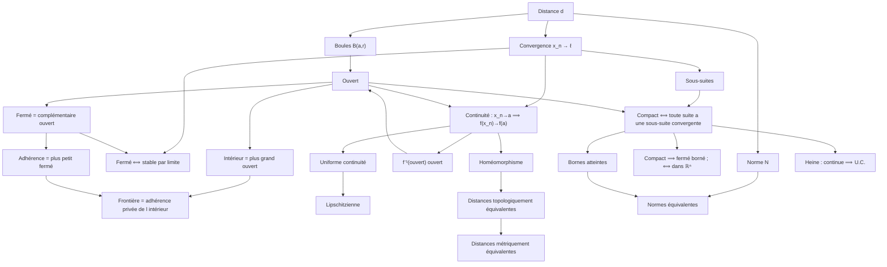

---
aliases:
  - "Index des définitions topologie"
  - "Sommaire topologie"
tags:
  - topologie
---

# 🗂️ Topologie – Index des définitions, théorèmes et méthodes

Point d'entrée pour retrouver n'importe quelle notion. Dans Obsidian : `Ctrl/Cmd + O` puis le nom (les alias marchent : « adhérence », « Heine », « fermé borné »…). · Retour à la [[L3/topologie/README|fiche matière]]

## 🚀 Révision express (examen du mercredi 18 novembre)

- 📅 [[topo-plan-de-revision|Plan de révision]] : quoi faire, jour par jour
- 📘 [[topo-fiche-definitions|Toutes les définitions sur une page]] · ⭐ [[topo-fiche-theoremes|Tous les énoncés sur une page]]
- 🧭 [[topo-reconnaitre-exercice|Reconnaître le type d'exercice]] : énoncé → méthode → première phrase
- ✍️ [[topo-exercices-types-corriges|Exercices types corrigés]] (20 rédactions modèles, dont toutes les annales)
- ✅ [[topo-vrai-faux-classiques|Vrai/Faux classiques]] · 🚨 [[topo-mes-erreurs|Mes erreurs à ne plus faire]]
- 🧩 [[topo-exemples-et-contre-exemples|Exemples et contre-exemples à connaître]]

## 📘 Définitions par chapitre

### [[01-espaces-metriques|1 – Espaces métriques, e.v.n.]]
- [[topo-distance|Distance, espace métrique]] · *Déf. 1.1*
- [[topo-distance-discrete|Distance discrète]] · *Ex. 1.2 (3)*
- [[topo-norme|Norme, espace vectoriel normé]] · *Déf. 1.5*
- [[topo-distance-associee-norme|Distance associée à une norme]] · *Déf. 1.7*
- [[topo-normes-usuelles|Normes usuelles de K^n et de C([a,b])]] · *Ex. 1.10 et 1.11*
- [[topo-boules-spheres|Boules et sphères]] · *Déf. 1.13*
- [[topo-partie-bornee-diametre|Partie bornée, diamètre]] · *Déf. 1.16*
- [[topo-distance-induite|Distance induite, sous-espace métrique]] · *Déf. 1.19*
- [[topo-distance-produit|Distance produit]] · *Prop. 1.22*
- [[topo-suite-convergente|Suite convergente]] · *Déf. 1.24*
- [[topo-suite-extraite|Suite extraite]] · *Déf. 1.26*
- [[topo-suite-bornee|Suite bornée]] · *Déf. 1.30*

### [[02-topologie-espaces-metriques|2 – Topologie des espaces métriques]]
- [[topo-ouvert|Ouvert]] · *Déf. 2.1*
- [[topo-ferme|Fermé]] · *Déf. 2.2*
- [[topo-voisinage|Voisinage]] · *Déf. 2.14*
- [[topo-interieur|Intérieur]] · *Déf. 2.18*
- [[topo-adherence|Adhérence]] · *Déf. 2.22*
- [[topo-partie-dense|Partie dense]] · *Déf. 2.26*
- [[topo-frontiere|Frontière]] · *Déf. 2.28*
- [[topo-continuite|Continuité en un point]] · *Déf. 2.31*
- [[topo-continuite-uniforme|Uniforme continuité]] · *Déf. 2.38*
- [[topo-application-lipschitzienne|Application lipschitzienne]] · *Déf. 2.42*
- [[topo-isometrie|Isométrie]] · *Déf. 2.45*
- [[topo-homeomorphisme|Homéomorphisme]] · *Déf. 2.52*
- [[topo-distances-topologiquement-equivalentes|Distances topologiquement équivalentes]] · *Déf. 2.57*
- [[topo-distances-metriquement-equivalentes|Distances métriquement équivalentes]] · *Déf. 2.60*
- [[topo-normes-equivalentes|Normes équivalentes]] · *Déf. 2.64*
- [[topo-norme-operateur|Norme d'une application linéaire continue]] · *Déf. 2.71*
- [[topo-distance-a-une-partie|Distance d'un point à une partie, entre deux parties]] · *TD, exercice 2.13 (corrigé dans le cours, § 2.17.4)*

### [[03-espaces-metriques-compacts|3 – Espaces métriques compacts]]
- [[topo-recouvrement|Recouvrement]] · *Déf. 3.1*
- [[topo-espace-compact|Espace compact]] · *Déf. 3.3*
- [[topo-partie-compacte|Partie compacte]] · *Déf. 3.8*
- [[topo-suite-de-cauchy-espace-complet|Suite de Cauchy, espace complet]] · *Déf. 3.15*

## 🔤 Définitions par ordre alphabétique

- [[topo-adherence|Adhérence]]
- [[topo-application-lipschitzienne|Application lipschitzienne]]
- [[topo-boules-spheres|Boules et sphères]]
- [[topo-continuite|Continuité en un point]]
- [[topo-distance-associee-norme|Distance associée à une norme]]
- [[topo-distance-a-une-partie|Distance d'un point à une partie, entre deux parties]]
- [[topo-distance-discrete|Distance discrète]]
- [[topo-distance-induite|Distance induite, sous-espace métrique]]
- [[topo-distance-produit|Distance produit]]
- [[topo-distance|Distance, espace métrique]]
- [[topo-distances-metriquement-equivalentes|Distances métriquement équivalentes]]
- [[topo-distances-topologiquement-equivalentes|Distances topologiquement équivalentes]]
- [[topo-espace-compact|Espace compact]]
- [[topo-ferme|Fermé]]
- [[topo-frontiere|Frontière]]
- [[topo-homeomorphisme|Homéomorphisme]]
- [[topo-interieur|Intérieur]]
- [[topo-isometrie|Isométrie]]
- [[topo-norme-operateur|Norme d'une application linéaire continue]]
- [[topo-norme|Norme, espace vectoriel normé]]
- [[topo-normes-equivalentes|Normes équivalentes]]
- [[topo-normes-usuelles|Normes usuelles de K^n et de C([a,b])]]
- [[topo-ouvert|Ouvert]]
- [[topo-partie-bornee-diametre|Partie bornée, diamètre]]
- [[topo-partie-compacte|Partie compacte]]
- [[topo-partie-dense|Partie dense]]
- [[topo-recouvrement|Recouvrement]]
- [[topo-suite-bornee|Suite bornée]]
- [[topo-suite-convergente|Suite convergente]]
- [[topo-suite-de-cauchy-espace-complet|Suite de Cauchy, espace complet]]
- [[topo-suite-extraite|Suite extraite]]
- [[topo-continuite-uniforme|Uniforme continuité]]
- [[topo-voisinage|Voisinage]]

## ⭐ Théorèmes par chapitre

### [[01-espaces-metriques|1 – Espaces métriques, e.v.n.]]
- [[topo-inegalite-triangulaire-generalisee|Inégalité triangulaire généralisée]] · *Prop. 1.3*
- [[topo-seconde-inegalite-triangulaire|Seconde inégalité triangulaire]] · *Prop. 1.4 et 1.6*
- [[topo-distance-et-norme|Distances qui viennent d'une norme]] · *Prop. 1.8*
- [[topo-proprietes-boules|Premières propriétés des boules]] · *Prop. 1.14*
- [[topo-proprietes-parties-bornees|Propriétés des parties bornées]] · *Prop. 1.17*
- [[topo-boules-sous-espace|Boules d'un sous-espace métrique]] · *Prop. 1.20*
- [[topo-boules-produit|Boules d'un produit, autres distances produit]] · *Prop. 1.23*
- [[topo-unicite-limite|Unicité de la limite]] · *Prop. 1.25*
- [[topo-suites-extraites-convergentes|Suites extraites d'une suite convergente]] · *Prop. 1.28 (et Lemme 1.27)*
- [[topo-convergente-bornee|Toute suite convergente est bornée]] · *Prop. 1.31*
- [[topo-convergence-produit|Convergence dans un produit]] · *Prop. 1.32*
- [[topo-convergence-evn|Convergence dans un e.v.n.]] · *Prop. 1.33*

### [[02-topologie-espaces-metriques|2 – Topologie des espaces métriques]]
- [[topo-boule-ouverte-ouverte|Une boule ouverte est un ouvert]] · *Prop. 2.5*
- [[topo-boule-fermee-fermee|Une boule fermée est un fermé]] · *Prop. 2.6*
- [[topo-stabilite-ouverts|Stabilité des ouverts]] · *Th. 2.7 et Ex. 2.8*
- [[topo-ouverts-reunions-de-boules|Un ouvert est une réunion de boules ouvertes]] · *Prop. 2.9*
- [[topo-stabilite-fermes|Stabilité des fermés]] · *Th. 2.10*
- [[topo-exemples-fermes|Singletons, parties finies et sphères sont fermés]] · *Prop. 2.11*
- [[topo-caracterisation-sequentielle-fermes|Caractérisation séquentielle des fermés]] · *Th. 2.12*
- [[topo-voisinages-et-boules|Voisinages et boules]] · *Prop. 2.15, 2.16 et Th. 2.17*
- [[topo-caracterisation-interieur|Caractérisation et propriétés de l'intérieur]] · *Prop. 2.19 et 2.20*
- [[topo-caracterisation-adherence|Caractérisations de l'adhérence]] · *Prop. 2.23 et 2.24*
- [[topo-complementaire-interieur-adherence|Intérieur et adhérence échangés par complémentaire]] · *Prop. 2.25*
- [[topo-proprietes-frontiere|Propriétés de la frontière]] · *Prop. 2.29*
- [[topo-caracterisations-continuite-point|Caractérisations de la continuité en un point]] · *Th. 2.33*
- [[topo-continuite-globale|Continuité globale : image réciproque]] · *Th. 2.34*
- [[topo-composition-continues|Composition d'applications continues]] · *Th. 2.35 et 2.41*
- [[topo-operations-fonctions-continues|Opérations sur les fonctions continues réelles]] · *Prop. 2.36*
- [[topo-hierarchie-lipschitz-uc-continue|Lipschitzienne ⇒ uniformément continue ⇒ continue]] · *Prop. 2.39 et 2.43*
- [[topo-isometries|Propriétés des isométries]] · *Prop. 2.46*
- [[topo-continuite-composantes|Continuité dans un produit]] · *Prop. 2.47, Th. 2.48, Prop. 2.50*
- [[topo-bijections-continues-de-r|Bijections continues de R ; homéomorphismes classiques]] · *Ex. 2.53, Prop. 2.54, Ex. 2.55*
- [[topo-critere-des-boules|Critère des boules (distances topologiquement équivalentes)]] · *Prop. 2.59*
- [[topo-metriquement-implique-topologiquement|Métriquement équivalentes ⇒ topologiquement équivalentes]] · *Prop. 2.61, Ex. 2.62, Rem. 2.63*
- [[topo-normes-equivalentes-encadrement|Normes équivalentes : caractérisation par encadrement]] · *Prop. 2.65 et Ex. 2.66*
- [[topo-applications-lineaires-continues|Continuité d'une application linéaire]] · *Th. 2.69*
- [[topo-proprietes-norme-operateur|Propriétés de la norme d'opérateur]] · *Prop. 2.72 et Ex. 2.73*

### [[03-espaces-metriques-compacts|3 – Espaces métriques compacts]]
- [[topo-equivalence-normes-dimension-finie|Équivalence des normes en dimension finie]] · *Th. 2.67 = Th. 3.34 et Cor. 3.35*
- [[topo-version-fermes-compacite|Compacité : version « fermés » et fermés emboîtés]] · *Prop. 3.5 et 3.6*
- [[topo-bolzano-weierstrass|Caractérisation séquentielle des compacts (Bolzano–Weierstrass)]] · *Th. 3.11 et Lemme 3.12*
- [[topo-bolzano-weierstrass-dans-r|Bolzano–Weierstrass dans R ; les segments sont compacts]] · *Th. 3.13*
- [[topo-convergente-cauchy|Suites de Cauchy : convergente ⇒ Cauchy ; Cauchy + sous-suite convergente ⇒ convergente]] · *Prop. 3.16 et Lemme 3.17*
- [[topo-compact-complet-borne|Un compact est complet et borné ; une partie compacte est fermée et bornée]] · *Prop. 3.18, 3.19 et Rem. 3.20*
- [[topo-ferme-dans-compact|Un fermé dans un compact est compact]] · *Prop. 3.21*
- [[topo-borel-lebesgue|Borel–Lebesgue : compacts de R et de R^n]] · *Th. 3.22 et Cor. 3.25*
- [[topo-reunions-intersections-compacts|Réunion finie et intersection de compacts]] · *Prop. 3.23*
- [[topo-produit-de-compacts|Produit de compacts]] · *Prop. 3.24*
- [[topo-image-continue-compact|Image continue d'un compact ; bijection continue sur un compact]] · *Prop. 3.27 et 3.28*
- [[topo-bornes-atteintes|Une fonction continue sur un compact est bornée et atteint ses bornes]] · *Th. 3.30*
- [[topo-heine|Théorème de Heine]] · *Th. 3.32*
- [[topo-riesz|Théorème de Riesz]] · *Th. 3.36 et Ex. 3.37*

## 🛠️ Méthodes par chapitre

### [[01-espaces-metriques|1 – Espaces métriques, e.v.n.]]
- [[topo-montrer-distance|Méthode : montrer qu'une application est une distance]] · *Méthode 1.1*
- [[topo-montrer-norme|Méthode : montrer qu'une application est une norme]] · *Méthode 1.2*
- [[topo-determiner-boule|Méthode : déterminer et dessiner une boule]] · *Méthode 1.3*
- [[topo-etudier-convergence-suite|Méthode : montrer qu'une suite converge (ou non)]] · *Méthode 1.4*

### [[02-topologie-espaces-metriques|2 – Topologie des espaces métriques]]
- [[topo-montrer-ouvert-ferme|Méthode : montrer qu'une partie EST ouverte ou fermée]] · *Méthode 2.1*
- [[topo-montrer-pas-ouvert-pas-ferme|Méthode : montrer qu'une partie N'EST PAS ouverte / PAS fermée]] · *Méthode 2.1 (point 5)*
- [[topo-calculer-interieur-adherence-frontiere|Méthode : calculer intérieur, adhérence, frontière]] · *Méthode 2.2*
- [[topo-distance-induite-ouverts-relatifs|Méthode : ouverts et fermés d'un sous-espace (distance induite)]] · *Prop. 1.20 et preuve de la Prop. 3.9*
- [[topo-continuite-deux-variables|Méthode : continuité d'une fonction de deux variables en (0,0)]] · *Méthode 2.3*
- [[topo-uniforme-continuite|Méthode : montrer (ou réfuter) l'uniforme continuité]] · *Méthode 2.4*
- [[topo-comparer-distances|Méthode : comparer deux distances]] · *§ 2.10–2.11*
- [[topo-montrer-normes-equivalentes|Méthode : normes équivalentes ou non]] · *Méthode 2.5*
- [[topo-application-lineaire-norme-operateur|Méthode : continuité d'une application linéaire, norme d'opérateur]] · *Méthode 2.6*

### [[03-espaces-metriques-compacts|3 – Espaces métriques compacts]]
- [[topo-montrer-compact|Méthode : montrer qu'une partie est compacte]] · *Méthode 3.1*
- [[topo-montrer-non-compact|Méthode : montrer qu'une partie n'est pas compacte]] · *Méthode 3.2*
- [[topo-exploiter-compacite|Méthode : exploiter la compacité]] · *Méthode 3.3*
- [[topo-somme-a-plus-b|Méthode : la somme A + B]] · *Écrit 2022-23 et interro 2025-26 (utilise Th. 3.11, Prop. 3.24, 3.27)*

## 🗺️ Carte des notions

